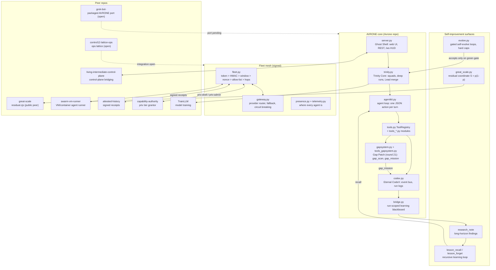
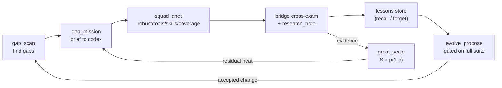

# Advanced Systems Architecture — Gap Patch and the Recursive Learning Upgrade Loop

Round 21. This document is the master map: how AVRONE's repos wire together, where the
gaps hide, how the Gap Patch (new in round 21) parses them, and how findings become a
long-horizon mission that feeds the recursive learning upgrade loop.

## 1. System assembly map

Open integration threads (from the 35-repo audit): `grok-bot-` (packaged AVRONE port) and
`control12-lattice-ops` are dashed because nothing wires them yet - both are round-22+
candidates for the Gap Patch to probe.

## 2. Gap taxonomy

Gaps fall into five classes, each with a checker:

| Class | What it looks like | Checker |
|---|---|---|
| Wiring | a tool module exists but `register_extra_tools` never calls its register function | `check_wiring` |
| Documentation drift | README/tools table/skill text claims a tool that does not exist | `check_tools_docs` |
| Cap mapping | an env cap exists in `tools_limits._limits()` but no skill explains the refusal | `check_skill_caps` + `check_env_docs` |
| Version coherence | `pyproject.toml` and `avrone/__init__.py` disagree, or tags drift | `check_versions` |
| Hidden depth | a module touched by a release but not reflected in skills or docs | per-module heuristics |

The live round-21 finding is class 3: `AVRONE_SPAWN_CONTEXT_CHARS` is a real `_limits()`
row but `skills/load-limits/SKILL.md` never maps it - an agent whose spawn was truncated
had no documented reason to look there.

## 3. The Gap Patch component model

- `avrone/gapsystem.py` - the engine. A bounded, static, offline scan of the checkout
  (root resolved via `AVRONE_REPO_DIR` -> settings -> workspace, both marker files
  required): every module file under `avrone/`, every `skills/*/SKILL.md`, `README.md`,
  `pyproject.toml`, `avrone/__init__.py`. Constants cap the blast radius:
  at most 400 files, 256 KB per file, 50 findings, 12,000 chars of output.
- `avrone/tools_gapsystem.py` - the two tools:
  - `gap_scan` (read-only): run the scan, return findings classed by scope with counts.
  - `gap_mission` (acting): emit a `gap.mission` event to the Eternal CodeX and return a
    structured mission brief (goal, lanes, tools to use, constraints, output format).
- Wired through `register_extra_tools` alongside the packpeer tools; every other module
  stays untouched.

Design lines: read-only unless the tool is named acting; no secrets, no event content in
output; one scan per call, no background loop; the scan never writes to the repo, only
the mission emits.

## 4. Long-Horizon Mission Protocol

`gap_mission` produces the brief; the squad executes it through existing surfaces:

1. **Recon**: `gap_scan`, `registry_audit`, `inspect_tool`, `read_file` - map the gaps.
2. **Board**: `task_board` add/update - one lane per gap class, owner per lane.
3. **Converge**: `bridge_post` / `bridge_reply` / `bridge_status` - cross-examine findings.
4. **Record**: `research_note` (finding/conclusion) - durable, feeds the lessons store.
5. **Recall**: `lesson_recall` at run start, `lesson_forget` when a lesson is disproved.
6. **Act**: `evolve_propose` / `evolve_loop` for code changes, gated on the full suite.
7. **Score**: `great_scale` - map verification evidence to the residual coordinate.

The loop is recursive by construction: every accepted evolve proposal or verified lesson
changes the system, which changes the next `gap_scan`, which spawns the next mission.

## 5. Recursive Learning Upgrade Loop wiring

Caps keep it honest: `AVRONE_EVOLVE_MAX_ITERS` (10) and `AVRONE_EVOLVE_TIME_BUDGET`
(1800 s), at most `AVRONE_EVOLVE_MAX_BG` (4) background loops, new-files-only proposals,
and the full offline suite as the only acceptance gate.

## 6. Deployment architecture (round-21 decision)

Primary: **own VPS** (Hetzner class, ~EUR 5.99/mo for 4 vCPU / 8 GB) - the only place
Ollama/GPU and a persistent `AVRONE_DATA_DIR` volume (fleet replay cache) both work.
Optional fleet edge: Fly.io (~$20/mo) for dispatch/offload, never for model hosting.
Loopback-only by default (`AVRONE_HOST=127.0.0.1`, `AVRONE_PUBLIC_ACCESS=loopback`),
tokens from `openssl`, reverse proxy + TLS for any exposure, `exposure_check` before
opening a single route. Full procedure: `deploy/vps-bootstrap.sh` + `deploy/VPS_RUNBOOK.md`.

## 7. Round-21 patch inventory (candidate branch `squad21/gap-patch`)

| File | Lane | Status |
|---|---|---|
| `avrone/gapsystem.py` | tools | candidate, gate pending |
| `avrone/tools_gapsystem.py` | tools | candidate, gate pending |
| `avrone/tools_extra.py` (wire-in, 2 lines) | tools | candidate, gate pending |
| `skills/load-limits/SKILL.md` (maps `AVRONE_SPAWN_CONTEXT_CHARS`) | robust | candidate, gate pending |
| `tests/test_tool_gap_scan.py` | tools | candidate, gate pending |
| `skills/systems-gap-bridge/SKILL.md` | skills | candidate, gate pending |
| `tests/test_skill_r21.py` | skills | candidate, gate pending |
| `deploy/vps-bootstrap.sh` | deploy | candidate |
| `deploy/VPS_RUNBOOK.md` | deploy | candidate |
| `docs/ADVANCED_SYSTEMS_ARCHITECTURE.md` | docs | candidate |

Status legend: "candidate" = pushed to `squad21/gap-patch`, not merged; "gate pending" =
the authoring sandbox cannot run Python, so the 2908-test offline suite must be run by
the owner before Lead merge. Per the master prompt: no test or coverage number is claimed
that did not come from a command actually run.

## 8. Open threads

- Merge `squad21/gap-patch` after a green gate; Lead bumps to v0.35.0 in both version
  files, adds the README `## v0.35` section, rebuilds `avrone.zip`, tags, pushes.
- Re-run `tools/model_bench.py` on the new VPS (llama3.2:3b, qwen3.5:4b, gemma3:4b with
  enough RAM) and pick the final default model.
- Port the Ollama profile into `grok-bot-` (packaged AVRONE); wire `control12-lattice-ops`.
- Extend `gap_scan` to read the fleet registry state for peer-repo wiring gaps (round 22).
